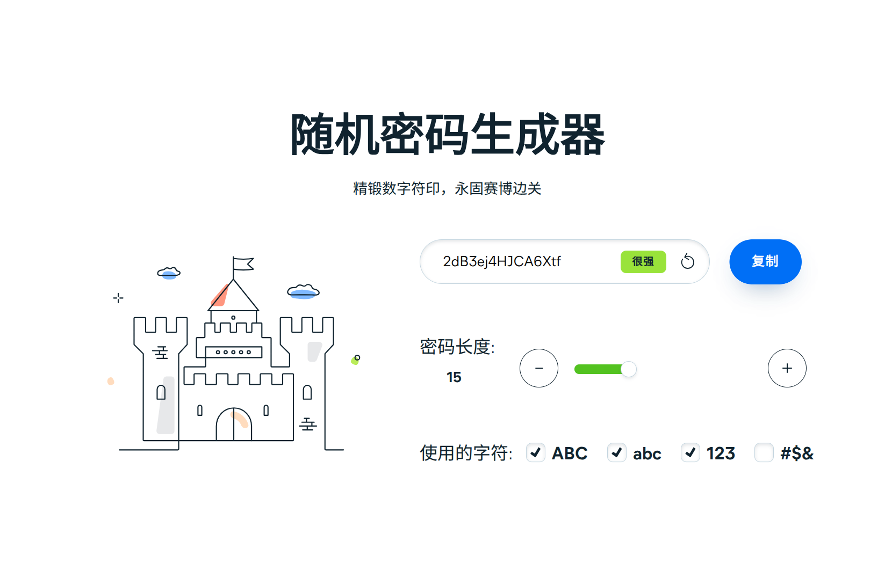

# Random-Password-Generator

随机密码生成器 by lingyicute - 精锻数字符印，永固赛博边关



## Try it

[p.92li.uk](https://p.92li.uk)

## Running tests

The Playwright suite runs in Chromium, Firefox, and WebKit. Install dependencies and all three browser engines, then run the suite:

```sh
npm ci
npx playwright install --with-deps chromium firefox webkit
npm test
```

The Playwright config serves this static site locally with Python 3. Tests cover password length and selected character sets, the minimum-one-character-class rule, clipboard success/failure feedback, length boundaries, responsive layout and horizontal overflow from narrow mobile through desktop viewports, and key accessibility behavior across the three engines.

## 🗂️ License

Random-Password-Generator is released under the GNU General Public License v3.0 (GPLv3).

Copyright (C) 2024-2026 lingyicute.

This program is free software: you can redistribute it and/or modify
it under the terms of the GNU General Public License as published by
the Free Software Foundation, either version 3 of the License, or
(at your option) any later version.

This program is distributed in the hope that it will be useful,
but WITHOUT ANY WARRANTY; without even the implied warranty of
MERCHANTABILITY or FITNESS FOR A PARTICULAR PURPOSE.  See the
GNU General Public License for more details.

You should have received a copy of the GNU General Public License
along with this program.  If not, see https://www.gnu.org/licenses.
